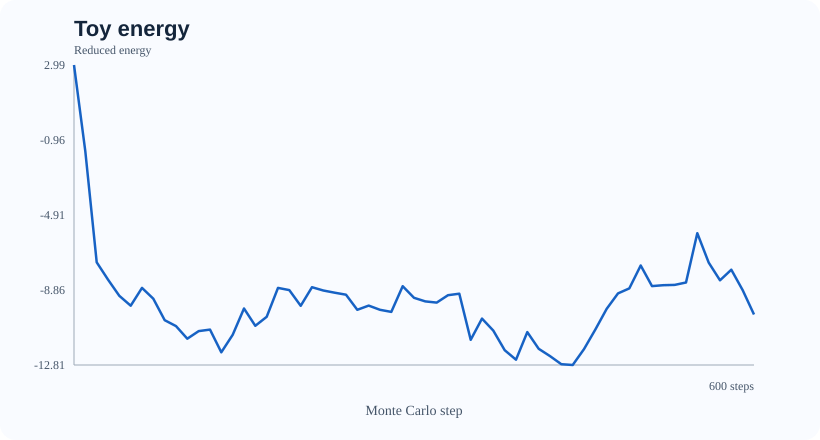
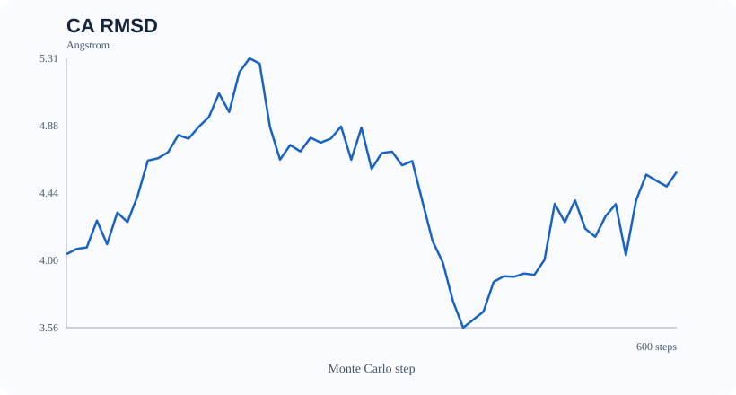
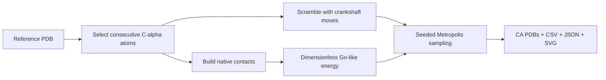

# Protein-MC-Go

**A reproducible, native-biased Monte Carlo demonstration for protein Cα conformations.**

[](https://www.python.org/)
[](LICENSE)

> [!IMPORTANT]
> **This is not a de novo protein-folding predictor, molecular dynamics engine, or
> physically validated force field.** The known reference structure defines its
> contact-energy landscape. The project is useful for teaching Monte Carlo,
> exploring conformational perturbations, practicing computational structural
> biology, and building reproducible scientific software.

## What you get

- Deterministic, independently seeded **Metropolis Monte Carlo** runs.
- **Crankshaft moves** that preserve consecutive Cα–Cα distances.
- A clearly documented **dimensionless Go-like toy potential** with reference-derived
  attractive contacts and nonlocal excluded-volume repulsion.
- Reproducible Cα-only PDBs, energy/RMSD trace plots (SVG), CSV metrics, and a JSON
  run manifest with source-file SHA-256 and configuration.
- CLI entry point (single-run and multi-seed diagnostics), Python package layout, tests, and GitHub Actions CI.
- A small *synthetic* helix PDB fixture that runs without network access.

## Quick start

```bash
python -m venv .venv
source .venv/bin/activate     # Windows: .venv\Scripts\activate
python -m pip install -e ".[dev]"

protein-mc run \
  --pdb examples/synthetic_helix_ca.pdb \
  --chain A --steps 1500 --scramble-steps 300 \
  --temperature 1.0 --seed 42 --outdir results/helix

python -m pytest -q

# Independent seed-sweep (diagnostic, not model-accuracy benchmark)
protein-mc benchmark --pdb examples/synthetic_helix_ca.pdb \
  --chain A --steps 600 --n-replicates 5 --outdir results/seed-sweep
```

If shell entry points are unavailable, use `python -m protein_mc run ...`.

**Input:** A local single-chain `.pdb` file with consecutive residue numbering,
standard amino-acid residues and Cα atoms (five to 300 residues).
A Cα-only PDB is sufficient. The CLI selects the first suitable chain by default;
use `--chain A` to choose explicitly. Models with gaps, missing Cα atoms or more
than 300 selected residues are outside the intended toy-demo scope.

## Multi-seed diagnostic

`protein-mc benchmark` runs independent seeded simulations with one shared,
read-only native reference and exports `replicates.csv` plus
`benchmark_summary.json` (mean, sample standard deviation, min, max).
Variability across seeds is useful for *software diagnostics*, but it is
**not** evidence of sampling convergence or de novo folding accuracy.

## Example visualization

These SVG charts were generated by the CLI using the synthetic fixture and seed 42;
they show a **toy energy and Cα RMSD trajectory**, not experimentally validated folding.





## Outputs

| File | Meaning |
| --- | --- |
| `initial_ca.pdb` | Scrambled starting Cα conformation |
| `best_ca.pdb` | Lowest *toy-energy* sampled conformation (not necessarily lowest RMSD) |
| `final_ca.pdb` | Final Cα conformation |
| `metrics.csv` | Steps, reduced energy, Kabsch RMSD, native-contact fraction, acceptance |
| `summary.json` | Seed, parameters, SHA-256 input, best/final metrics, limitations |
| `energy_trace.svg` | Portable vector visualization of toy energy |
| `rmsd_trace.svg` | Portable vector visualization of Cα RMSD |

Coordinates and RMSD are in **Ångström**; `temperature` is a **dimensionless
reduced temperature** (`k_B T` measured in toy-energy units), **not Kelvin**.
The acceptance rule is `min(1, exp(-ΔE/T_reduced))`.

## Model overview



For residues `i,j` with `|i-j| >= 4`, the toy energy is:

\[
E(\mathbf X)=\frac{k_r}{2}\sum_{i,j}\max(0,r_{min}-r_{ij})^2
-\epsilon\sum_{(i,j)\in C_{native}}
\exp\left[-\frac{(r_{ij}-r_{ij}^{ref})^2}{2w^2}\right]
\]

Here `C_native` is defined by **distances in the supplied reference PDB**.
The simulation therefore *cannot* infer a native structure from sequence alone.
See [scientific notes](docs/SCIENTIFIC_NOTES.md) for methodological limitations.

## Project structure

```text
src/protein_mc/       Package: structure IO, geometry, energy, Monte Carlo, CLI, SVG
examples/             Synthetic, openly reusable toy input
assets/               Genuine CLI-generated demo plots
tests/                Unit and end-to-end regression tests
docs/                 Scientific limitations + migration notes
.github/workflows/    Python 3.10 / 3.12 CI
```

## Reproducibility

Run the same command, inputs and Python/NumPy versions with the same `--seed` to
reproduce a trajectory. Save `summary.json` alongside all results. Running the
sampler never mutates the supplied reference coordinates. Separate simulations
should create their own model and RNG instances. No hidden web downloads occur.

To reproduce the chart in this README:

```bash
protein-mc run --pdb examples/synthetic_helix_ca.pdb \
  --chain A --steps 600 --scramble-steps 120 --seed 42 \
  --report-every 10 --outdir results/readme-demo
```

## Roadmap

- [x] Dimensionally consistent reduced-energy Metropolis acceptance
- [x] Independent random generator and immutable native coordinates
- [x] CLI, packaging, validation, CI, synthetic fixture, SVG reports
- [ ] PDB selection with missing residues / insertion codes
- [ ] Additional Monte Carlo moves and convergence/replica diagnostics
- [ ] Comparison with established structure modeling packages
- [ ] Optional visual 3D frontend and wider structural test suite

## Relation to the original repository

This is a **scientifically corrected v1 rewrite** of the original small script.
The original script in the repository is not silently treated as validated
protein folding. See [migration notes](docs/MIGRATION.md).

## License

MIT. See [LICENSE](LICENSE). Scientific use requires independent validation.